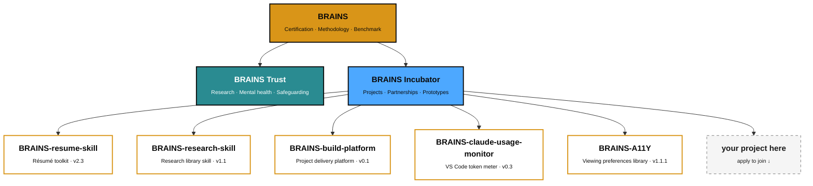

<div align="center">

<picture>
  <source media="(prefers-color-scheme: dark)" srcset="https://raw.githubusercontent.com/BRAINS-Certified/.github/main/profile/brand-mark-dark-bg.png">
  
</picture>

# BRAINS

**The global benchmark for neuro-affirming AI.**

<br />

[](mailto:info@brainscertified.com?subject=Incubator%20application%20%E2%80%94%20%5Byour%20name%5D)
[](https://discord.gg/BEmTXXscBr)
[](https://brainscertified.com)
[](https://bsky.app/profile/brainscertified.com)
[](mailto:info@brainscertified.com)

<br />

[Jump to: how to apply to join the Incubator](#apply-to-join-the-incubator)

</div>

---

## What BRAINS is

BRAINS exists because the people who built today's AI did not design for the people most affected by it.

We benchmark and certify AI systems against a method developed **with**, not just **for**, neurodivergent people. The work is meant to be rigorous and public. Scoring rubrics, method notes and findings are shared so that people can challenge them, improve them and build on them.

> **Reliable, affirming, inclusive.**

---

## How BRAINS is organised

The diagram below shows the parts of BRAINS and the projects in the Incubator. A text version follows it.



**The same structure as a list:**

- **BRAINS** covers certification, method and the public benchmark. It has two parts:
  - **BRAINS Trust** covers research, mental health and safeguarding.
  - **BRAINS Incubator** covers new projects, partnerships and prototypes, including community-led builds. Its live projects are:
    - BRAINS-resume-skill, a résumé toolkit (v2.3)
    - BRAINS-research-skill, a research library skill (v1.1)
    - BRAINS-build-platform, a project delivery platform (v0.1)
    - BRAINS-claude-usage-monitor, a VS Code token meter (v0.3)
    - BRAINS-A11Y, a library of viewing preferences (v1.1.1)
    - Your project, if you apply to join (see below)

| Part | Focus |
|---|---|
| BRAINS | Certification, method and the public benchmark. |
| BRAINS Trust | Research, mental health and safeguarding. |
| BRAINS Incubator | New projects, partnerships and prototypes, including community-led builds. |

---

## The BRAINS Incubator

The Incubator is where new tools that affirm neurodivergent people get built. Some are internal research and development. Many are community-led projects that grow under the BRAINS name, with brand, method and, where possible, practical support.

We are looking for contributors: coders, designers, researchers, writers, people with lived experience, and people who care about getting this right.

### Live projects

| Project | Version | What it is |
|---|---|---|
| **[BRAINS-resume-skill](https://github.com/BRAINS-Certified/BRAINS-resume-skill)** | v2.3 | A résumé toolkit that is aware of neurodivergence. It covers ATS safety, bias checks, coaching on whether to disclose, and career-change translation. |
| **[BRAINS-research-skill](https://github.com/BRAINS-Certified/BRAINS-research-skill)** | v1.1 | A Claude Code skill that looks after the BRAINS research library. It extracts, de-duplicates and sorts PDFs into a fixed set of categories, and it has a review workflow for each paper. |
| **[BRAINS-build-platform](https://github.com/BRAINS-Certified/BRAINS-build-platform)** | v0.1 | A project delivery platform that affirms neurodivergent ways of working. It breaks work into packages, runs them with AI subagents, keeps a regular check-in rhythm and logs decisions. |
| **[BRAINS-claude-usage-monitor](https://github.com/BRAINS-Certified/BRAINS-claude-usage-monitor)** | v0.3 | A VS Code extension that reads Claude Code transcripts on your own machine. It shows your rolling 5-hour and 7-day token use. It makes no network calls and sends no telemetry. You download it from the GitHub releases page. |
| **[BRAINS-A11Y](https://github.com/BRAINS-Certified/BRAINS-A11Y)** | v1.1.1 | A library of eleven viewing preferences, such as theme, contrast, text size, spacing and motion, so that every page that uses it gets the same controls in the same place. It has no dependencies and works in React, in Astro and on plain HTML pages. Using the package does not make a site compliant. |
| _Your project_ | Open | Have an idea? Apply below with a one-paragraph pitch. |

More projects are on the way. Some of them might be yours.

### Standards and infrastructure

| Project | What it is |
|---|---|
| **[BRAINS-template-repo](https://github.com/BRAINS-Certified/BRAINS-template-repo)** | The starting point for every new BRAINS repo. It ships the security, accessibility and readability checks we run on our own code: OpenSSF Scorecard, CodeQL, Trivy, Gitleaks, Dependabot, Vale with the BRAINS rule pack, and a Flesch-Kincaid readability check. The accessibility checks are opt-in. |

### BRAINS Certified badges

Four of the projects above show the BRAINS Certified Gold badge in their README: BRAINS-build-platform, BRAINS-claude-usage-monitor, BRAINS-resume-skill and BRAINS-template-repo. We are bringing them up to our stricter criteria, and the badge stays while we do that.

A Gold badge does not cover accessibility. The accessibility checks are opt-in, so the badge says nothing about them either way.

---

## Apply to join the Incubator

<div align="center">

[](mailto:info@brainscertified.com?subject=Incubator%20application%20%E2%80%94%20%5Byour%20name%5D)

</div>

If you would like to work on an existing Incubator project, or propose a new one, [email info@brainscertified.com](mailto:info@brainscertified.com?subject=Incubator%20application%20%E2%80%94%20%5Byour%20name%5D) with the following:

```
Subject: Incubator application — [your name]

1. Who you are
   Name, location, anything about you that's relevant. Pronouns welcome.

2. What you'd want to work on
   An existing project (which one), a new project you'd like to start
   (a paragraph on what and why), or just "open to ideas — here's what
   interests me."

3. What you'd contribute
   Skills, experience, or perspective you bring. Lived experience is
   expertise — say so if it shapes your view of this work.

4. Time you can give
   Honest estimate. Five hours a month is welcome. Twenty hours a week
   is welcome. Both work.

5. Anything else
   Adjustments you'd want for working with us, questions you have,
   things we should know.
```

We reply to every application within seven working days. There is no diagnosis requirement and no formal qualification requirement. We assume good faith on first read.

---

## How we work

| Practice | What it means |
|---|---|
| **Async first** | Written communication is the default. Real-time meetings are short and have agendas. |
| **Adjustments by default** | Reasonable adjustments are offered without needing a diagnosis or a reason. |
| **Identity first** | We say "autistic person" by default, and switch to person-first wording when an individual asks us to. |
| **Findings before opinions** | Claims about AI behaviour cite the test and the data. |
| **Inclusion by construction** | The neurodivergent contributor is the person we assume is contributing, not the edge case. |

For more detail, read the [BRAINS Code of Conduct](https://github.com/BRAINS-Certified/BRAINS-template-repo/blob/main/CODE_OF_CONDUCT.md).

---

## Contact

- **Apply or propose a project:** [email info@brainscertified.com](mailto:info@brainscertified.com?subject=Incubator%20application%20%E2%80%94%20%5Byour%20name%5D)
- **Community:** [Join the BRAINS Discord](https://discord.gg/BEmTXXscBr)
- **Website:** [Visit brainscertified.com](https://brainscertified.com)
- **Bluesky:** [Follow @brainscertified.com on Bluesky](https://bsky.app/profile/brainscertified.com)
- **Press:** [email info@brainscertified.com about a press enquiry](mailto:info@brainscertified.com?subject=Press%20enquiry%20%E2%80%94%20%5Boutlet%5D)

---

<div align="center">

<br />

**Built by neurodivergent minds, for neurodivergent people.**

<br />

[](https://brainscertified.com)

</div>
